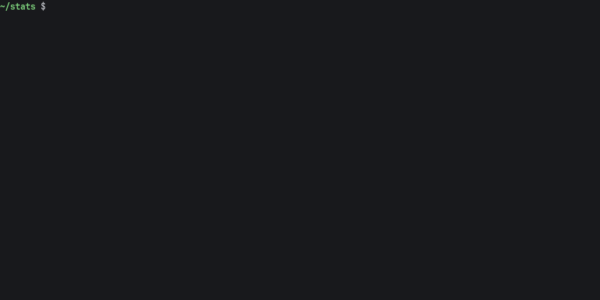

# dsh-romeo

[DeepSeek Harness](https://github.com/deepseek-ai/deepseek-harness) (dsh), DeepSeek's coding agent, on your computer, with its model, DeepSeek-V4.1-Flash, running on the GPUs of the [ROMEO](https://romeo.univ-reims.fr/) cluster. One command starts the model, opens the tunnel and opens dsh. The same model also serves any other client: opencode, Codex CLI, Claude Code, Aider, the OpenAI and Anthropic SDKs, your editor.



## Install

On your computer (macOS or Linux), once `ssh romeo` logs you into ROMEO without a password:

```bash
git clone https://github.com/wolf75222/dsh-romeo.git ~/dsh-romeo && ~/dsh-romeo/install.sh
```

It installs dsh if it is missing (`npm install -g @deepseek-ai/dsh`, Node.js 20 or later), asks which ROMEO project pays for the model jobs, links `dsh-romeo` in `~/.local/bin` and copies the model's fiche to `~/.romeollmtool/configs` on ROMEO. To update: `cd ~/dsh-romeo && git pull && ./install.sh`.

No `romeo` alias yet? Add it to `~/.ssh/config`:

```
Host romeo
    HostName romeo1.univ-reims.fr
    User <your ROMEO login>
    IdentityFile ~/.ssh/<your key registered on ROMEO>
```

## Use

| Command | |
|---|---|
| `dsh-romeo --launch` | starts the model (one job, 2 nodes, 8 GH200), waits until it answers (8 to 13 min in our tests), opens the dsh Web UI |
| `dsh-romeo` | opens the Web UI while the job runs |
| `dsh-romeo headless "run the tests and fix them"` | one task, the answer printed on stdout: for scripts |
| `dsh-romeo web --port 3000` | any dsh profile and argument pass through |
| `dsh-romeo --launch 3` | three jobs: the gateway spreads the agents over them |
| `dsh-romeo --run opencode` | another client instead of dsh (see [Other clients](#other-clients)) |
| `dsh-romeo --serve` | only the model and the tunnel: an endpoint for any tool |
| `dsh-romeo --status` | the gateway, the model jobs, the tunnel |
| `dsh-romeo --stop` | stops the model jobs and closes the tunnel |

`--launch` combines with the others: `dsh-romeo --launch --run opencode`.

The agents work on your computer: only the model runs on ROMEO. In the Web UI, a session works in the workspace chosen above the message box: on first use dsh creates `~/Documents/deepseek-harness/default-workspace`; add your project folder with the button next to *Workspaces*. `dsh-romeo headless` works in the current folder.

## Other clients

The gateway forwards every `/v1/...` request to vLLM, which speaks three APIs: OpenAI Chat Completions, OpenAI Responses and Anthropic Messages. So dsh is only one possible client. `dsh-romeo --run CMD` prepares the model and the tunnel like for dsh, then runs `CMD` with the endpoint in its environment:

| Client | Command | Through |
|---|---|---|
| [opencode](https://opencode.ai) | `dsh-romeo --run opencode` | a `romeo` provider in `~/.config/dsh-romeo/opencode.json`, given by `OPENCODE_CONFIG` and made the default model |
| [Codex CLI](https://github.com/openai/codex) | `dsh-romeo --run codex` | a `romeo` provider passed as `-c` options, on the Responses API |
| [Claude Code](https://code.claude.com) | `dsh-romeo --run claude` | `ANTHROPIC_BASE_URL`, `ANTHROPIC_AUTH_TOKEN` and the model for every alias |
| [Aider](https://aider.chat) | `dsh-romeo --run aider` | `OPENAI_API_BASE`, `OPENAI_API_KEY` and `AIDER_MODEL=openai/<model>` |
| OpenAI and Anthropic SDKs, curl, scripts | `dsh-romeo --run python3 my_agent.py` | `OPENAI_BASE_URL`, `OPENAI_API_KEY`, `ANTHROPIC_BASE_URL`, `DSH_ROMEO_MODEL` |

Arguments after the command are the client's own: `dsh-romeo --run codex exec "fix the tests"`, `dsh-romeo --run claude -p "..."`. None of these clients' own settings are modified.

For a tool you start yourself, or an editor (Continue, Cline, Zed, Cursor, ...):

```bash
dsh-romeo --serve            # the model and the tunnel, then it prints the endpoint and returns
eval "$(dsh-romeo --env)"    # the endpoint and the key in this shell
```

then declare an OpenAI-compatible provider with base URL `http://127.0.0.1:11318/v1`, model `dsh-deepseek-v4.1-flash-1m` and the key of `$OPENAI_API_KEY` (Anthropic-compatible tools: `http://127.0.0.1:11318`). The tunnel stays open until `dsh-romeo --stop`.

Tested on 2026-10-25 against one model job, each client asked to run the tests of a small project, fix its bug and run them again:

| Client | Version | Result |
|---|---|---|
| dsh | 0.2.1-rc.2 | fixed, tests pass (Web UI and headless) |
| opencode | 1.19.4 | fixed, tests pass |
| Codex CLI | 0.143.0 | fixed, tests pass (provider `romeo`, Responses API) |
| Claude Code | 2.1.197 | fixed, tests pass (10 turns, only `dsh-deepseek-v4.1-flash-1m` used) |
| Aider | 0.86.2 | fixed, tests pass (on macOS 27, Aider's pinned scipy 1.13 does not load: `uvx --overrides` with `scipy>=1.15`) |
| OpenAI Python SDK | 3.37.0 | tool call and streamed answer ([tests/clients/openai_sdk.py](tests/clients/openai_sdk.py)) |

## What it does

- **The model.** Launches DeepSeek-V4.1-Flash with ROMEO's own tool, `romeollmtool`, from a fiche tuned for agents (see [Tuning](#tuning)). ROMEO's validated fiche also works: one node, 262K tokens of context, longer to load (`DSH_ROMEO_FICHE=deepseek-v4.1-flash-vllm`).
- **The gateway.** Keeps `romeollmtool`'s gateway running on the login node: one URL and one key for all your model jobs, requests spread over them.
- **Waits for the model** with a real one-token request, and shows where the job is meanwhile: in the queue and why, or loading.
- **The tunnel.** One SSH connection carries every command and the tunnel `127.0.0.1:11318` to the gateway, reused from one run to the next and reopened after your computer slept.
- **dsh.** Runs dsh with an overlay (`dsh --patch`) that adds the `romeo` provider and makes DeepSeek-V4.1-Flash the default model, with maximum reasoning. Your own dsh profiles are not modified. The gateway's key goes to dsh through its environment and is never written to disk.
- **Web search** (optional): `install.sh --search` runs [SearXNG](https://docs.searxng.org/) in Docker on `127.0.0.1:8888` and plugs it into dsh's `web_search` tool.

## Tuning

What an A/B study on ROMEO (October 2026, up to 7 jobs and 3584 concurrent requests) kept, and where it is:

| | | Where |
|---|---|---|
| Tensor parallelism over 8 GH200 on 2 nodes, no pipeline parallelism | without patches that `romeollmtool` cannot load, the pipeline variants of V4.1 on vLLM 0.31 garble long agent contexts (12 to 18 sessions out of 24) | fiche |
| DSpark speculative decoding, 3 draft tokens; 32 CPUs per node; `--stream-interval 4` | 66 to 68 % of the drafts accepted in real dsh sessions; +61 % per agent at 16 agents per job and +70 % at 64, against 5 draft tokens and 8 CPUs | fiche |
| Full 1M context, 256K output, `--gpu-memory-utilization 0.78`, `--language-model-only` | the context the model was trained for; starts on every GH200 | fiche |
| DeepSeek's sampling (temperature 1.0, top_p 0.95), maximum reasoning by default | `DSH_ROMEO_EFFORT` to change it | fiche, launcher |
| Several jobs behind one gateway | `dsh-romeo --launch N` | launcher |
| Fast gateway: no 100-stream cap, session affinity across jobs, longer timeouts, 4 processes | 3584 of 3584 concurrent requests served (the standard gateway: 502 errors beyond about 100 streams); -20 to -28 % wall time and -59 % time to first token late in multi-turn sessions with several jobs | `DSH_ROMEO_GATEWAY=fast` |

With all of them, fast gateway included, 7 jobs served about 530 agents at once at 30 tokens/s each (235 multi-turn agents), against 165 for the first setup.

Left out on purpose: the pipeline-parallel variant with DSpark (more throughput only at saturation, and it needs vLLM patches that `romeollmtool` cannot load), and token savers that rewrite the agent's instructions (Caveman, Ponytail): they change how the agent works, so they are a choice for your own `AGENTS.md`.

The fast gateway is a second, unmanaged gateway on the login node ([share/gateway](share/gateway)): a patch of `romeollmtool`'s gateway loaded at start, the same key and the same jobs, 8 hours of life, stopped by `dsh-romeo --stop`. If it cannot start (for example after an update of `romeollmtool`), dsh-romeo says so and uses the standard gateway. Use it for more than 100 agents at once or several jobs; one job and a few agents do not need it.

## Settings

`install.sh` writes them to `~/.config/dsh-romeo/config`; a variable set in the environment wins.

| Variable | Default | |
|---|---|---|
| `ROMEO_PROJECT` | asked | Slurm project code charged for the model jobs |
| `ROMEO_SSH_HOST` | `romeo` | ssh alias of a ROMEO login node |
| `DSH_ROMEO_FICHE` | `dsh-deepseek-v4.1-flash-1m` | `romeollmtool` fiche of the model |
| `DSH_ROMEO_TIME` | `08:00:00` | duration of a model job (24 h at most) |
| `DSH_ROMEO_EFFORT` | `max` | default reasoning effort: `none`, `low`, `high`, `max` |
| `DSH_ROMEO_PORT` | `11318` | local port of the tunnel |
| `DSH_ROMEO_SEARXNG_URL` | empty | SearXNG for web search, e.g. `http://127.0.0.1:8888` |
| `DSH_ROMEO_GATEWAY` | `standard` | `fast`: the patched gateway (see [Tuning](#tuning)) |
| `DSH_ROMEO_FAST_PORT`, `DSH_ROMEO_FAST_PROCS` | `11320`, `4` | its port on the login node and its processes |

## Cost

A model job uses the GPU hours of your project for as long as it runs, even when no agent works: `dsh-romeo --stop` when you are done. It ends anyway after `DSH_ROMEO_TIME`. The gateway stops by itself 24 hours after the last `dsh-romeo`, and cancels your model jobs then.

## When something goes wrong

- **`cannot connect to 'romeo' over SSH`**: `ssh romeo hostname` must work without a password (see Install).
- **The job waits in the queue**: `dsh-romeo --status` says why (`Resources`: no free GPU nodes yet; `Priority`: other jobs first). Waiting can stop with Ctrl-C: the job stays in the queue and `dsh-romeo` picks it up later.
- **The job ends while loading**: read its log with `ssh romeo /apps/romeotools/romeollmtool/romeollmtool logs`. A node whose GPU memory is partly taken makes vLLM fail at start: `dsh-romeo --launch` again.
- **`cannot forward 127.0.0.1:11318`**: another program uses the port: set `DSH_ROMEO_PORT`.
- **dsh shows connection errors after your computer slept**: quit dsh and run `dsh-romeo` again; the tunnel is reopened and dsh keeps your sessions.

## Development

```bash
tests/run.sh                 # offline tests against a fake ROMEO (fake ssh, romeollmtool, squeue, gateway, codex)
dsh-romeo --run python3 tests/clients/openai_sdk.py   # the real endpoint through the OpenAI SDK
python tests/demo.py record  # records a real run for the GIF (launches a model job): terminal, then the Web UI
python tests/demo.py render  # draws img/dsh-romeo.gif
```

The demo needs `pyte`, `Pillow` and `playwright` (`python -m playwright install chromium`). `tests/tui.py` (driving a program in a pseudo-terminal and drawing its screen) comes from [RSV](https://github.com/wolf75222/RSV).
